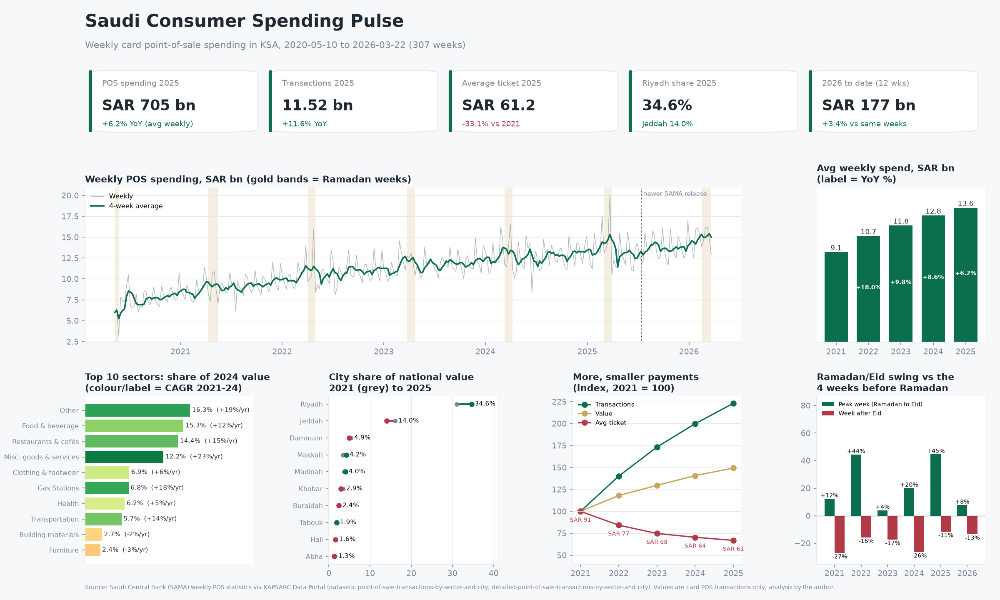
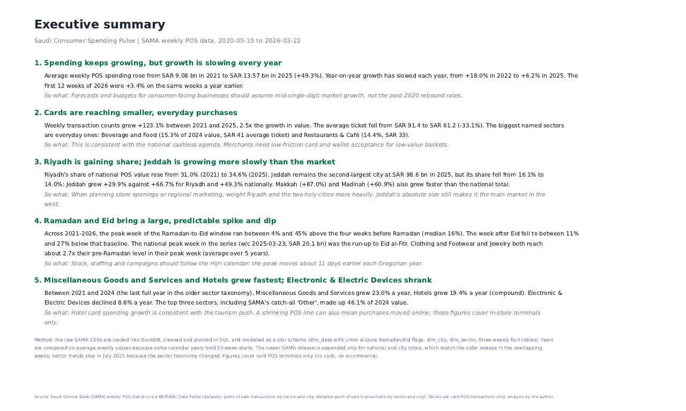
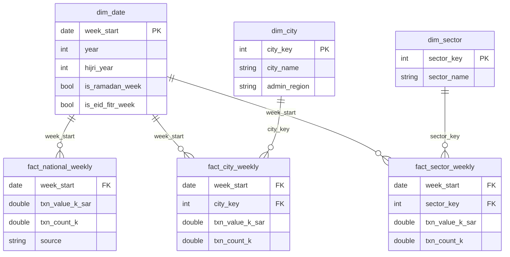

# Saudi Consumer Spending Pulse: a weekly POS KPI dashboard on SAMA data

**Python and DuckDB SQL pipeline plus a Power BI-style dashboard tracking card spending at points of sale across Saudi Arabia: 307 weeks of official Saudi Central Bank (SAMA) data, May 2020 to March 2026.**



Outputs: [interactive HTML dashboard](reports/dashboard.html) · [PDF (dashboard + executive summary)](reports/dashboard_and_summary.pdf) · [executive summary (Markdown)](reports/executive_summary.md) · [Power BI star schema CSVs](data/processed/)

---

## 1. Business problem

Retailers, banks, mall operators and FMCG brands in KSA plan inventory, staffing, branch openings and campaigns around consumer demand. SAMA publishes weekly point-of-sale (POS) figures by sector and city, but only as a long, flat bulletin. This project turns the bulletin into a dimensional model and a one-page KPI dashboard that answers:

1. How large is weekly card spending at points of sale, and how fast is it growing?
2. Which merchant sectors take the most spending, and which are growing fastest?
3. How is spending split across the major cities? Is Jeddah gaining or losing share against Riyadh?
4. Is the average ticket shrinking as cards spread to small, everyday purchases?
5. How much does spending swing around Ramadan and Eid al-Fitr?
6. What does the latest available data (to March 2026) show compared with a year earlier?

## 2. Key findings

All numbers are generated by `python run.py` and stored in [`data/processed/kpis.json`](data/processed/kpis.json). None are typed by hand.

| # | Finding |
|---|---|
| 1 | **Growth continues but has slowed every year.** Average weekly POS spending rose from SAR 9.08 bn (2021) to SAR 13.57 bn (2025), +49.3%. YoY growth went from +18.0% (2022) to +6.2% (2025). The first 12 weeks of 2026 were +3.4% on the same weeks of 2025. |
| 2 | **Cards are reaching smaller purchases.** Transactions grew +123.1% from 2021 to 2025, 2.5x the growth in value. The average ticket fell from SAR 91.4 to SAR 61.2 (-33.1%). |
| 3 | **Riyadh is gaining share.** Riyadh's share of national POS value went from 31.0% to 34.6%. Jeddah, still the second-largest city (SAR 98.6 bn in 2025), went from 16.1% to 14.0%: its spending grew +29.9% against +49.3% nationally. Makkah (+87.0%) and Madinah (+60.9%) grew faster than the national total. |
| 4 | **Ramadan and Eid bring a large, predictable spike and dip.** The peak week of the Ramadan-to-Eid window ran 4% to 45% above the four weeks before Ramadan (median 16%). The week after Eid fell 11% to 27% below that baseline. Clothing and footwear and jewelry reach about 2.7x their pre-Ramadan level in their peak week. |
| 5 | **Sector mix.** Food and beverage (15.3%) and restaurants and cafés (14.4%) are the largest named sectors (2024). Miscellaneous goods and services (+23.0%/yr) and hotels (+19.4%/yr) grew fastest from 2021 to 2024. Electronics shrank (-8.6%/yr), though some of that spending may have moved online, which POS data does not capture. |

The full narrative and "so what" notes are in the [executive summary](reports/executive_summary.md).



## 3. Data

| | Dataset | Publisher | Coverage | License |
|---|---|---|---|---|
| A | [Point of Sale Transactions by Sector and City](https://datasource.kapsarc.org/explore/dataset/point-of-sale-transactions-by-sector-and-city/) | Saudi Central Bank (SAMA), via KAPSARC Data Portal | Weekly, 2020-05-10 to 2025-07-06; 17 sectors, 11 cities | Public Domain (KAPSARC label); source copyright SAMA |
| B | [Detailed Point of Sale Transactions by Sector and City](https://datasource.kapsarc.org/explore/dataset/detailed-point-of-sale-transactions-by-sector-and-city/) | SAMA, via KAPSARC Data Portal | Weekly, 2025-06-29 to 2026-03-22; 32 sub-sectors, 61 cities | Public Domain (KAPSARC label); source copyright SAMA |

The exact download URLs, file hashes and download times are in [`data/raw/SOURCES.md`](data/raw/SOURCES.md) and `data/raw/manifest.json`. The raw CSVs are not committed; `make data` downloads them again from the public API (no key needed).

**Data issues found and handled**
- **Two releases with different taxonomies.** SAMA replaced the old series (A) with a more detailed one (B) in mid-2025. National and city totals match between A and B to within 0.01% in the overlapping weeks (this is tested), so they are stitched. Sector trends stop at July 2025 because B splits and renames sectors.
- **A mis-dated week.** One week is stamped Saturday 2020-06-20 instead of Sunday. All dates are snapped to the nearest Sunday week start, and the series is tested for gaps.
- **Units.** Values are in SAR thousands and counts are in thousands. Both are converted explicitly in SQL.
- **53-week years.** Years are compared on average weekly values, so 2023 (53 week-starts) is not inflated.
- **"Other" city.** This bucket is not comparable across A and B, so city analysis uses the 10 named cities.
- **Scope.** The data covers card POS terminals only, so cash and e-commerce are not included.

## 4. Approach

```
KAPSARC API ──► data/raw/*.csv ──► sql/01_staging.sql ──► sql/02_star_schema.sql ──► sql/03_kpis.sql ──► charts + reports
   (download.py)                    clean, map, pivot      star schema + stitching     CTEs + window fns     (matplotlib, Plotly)
                                                        ▲
                                     dim_date (Umm al-Qura Ramadan/Eid flags, Python)
```

**Star schema (exported as CSV for Power BI):**



**SQL techniques used:** `read_csv`, `UNION ALL BY NAME`, `CASE` mapping, `PIVOT`, CTEs, window functions (`LAG` for week-on-week and 52-week comparisons, rolling `AVG ... ROWS BETWEEN`, `SUM() OVER ()` for shares, `RANK`, `ROW_NUMBER`/`DENSE_RANK` for event windows), `ARG_MAX`, `ANTI JOIN` (in tests).

**KPI definitions**

| KPI | Definition |
|---|---|
| POS spending | Sum of weekly transaction value (SAR) over the period |
| Avg weekly spend | POS spending ÷ number of weeks (used for YoY so 53-week years compare fairly) |
| Transactions | Sum of weekly transaction counts |
| Average ticket | POS spending ÷ transactions (SAR per transaction) |
| City share | City POS spending ÷ national POS spending, same weeks |
| Sector CAGR 2021-24 | (avg weekly value 2024 ÷ avg weekly value 2021)^(1/3) − 1 |
| Ramadan peak index | Highest weekly value from the first Ramadan week to the Eid al-Fitr week ÷ average of the 4 weeks before Ramadan × 100 |
| Post-Eid index | Value in the week after the Eid al-Fitr week ÷ the same baseline × 100 |

## 5. Tools

Python 3.13 · pandas · **DuckDB (SQL)** · hijridate (Umm al-Qura calendar) · matplotlib (static dashboard, PNG/PDF) · Plotly (interactive HTML) · pytest · Make. Exact versions are pinned in [`requirements.txt`](requirements.txt).

## 6. Reproduce

```bash
git clone <this repo> && cd ksa-pos-spending-dashboard
make all            # creates .venv, installs pinned deps, downloads data, builds everything, runs tests
# or, without make:
python -m venv .venv && . .venv/bin/activate && pip install -r requirements.txt
python run.py       # add --refresh to re-download the latest SAMA data
pytest -q
```

The full pipeline runs in a few seconds after the download. SAMA updates the series weekly, so `--refresh` can change the latest-period figures. The committed outputs reflect the data snapshot recorded in `manifest.json`.

## 7. Tests and validation

`tests/test_data_quality.py` (22 checks) covers:
- raw files match the SHA-256 in the manifest, and every SAMA indicator is mapped;
- there are no duplicate keys, every week starts on a Sunday, and the weekly series has no gaps;
- all values are positive and not null, and foreign keys resolve;
- **reconciliation with the publisher:** sectors sum to the national total; the week-on-week % recomputed from levels reproduces SAMA's published change % (max error < 0.01 pp); the A and B releases agree in overlapping weeks;
- Ramadan/Eid flags are plausible for every Hijri year;
- all reports exist, and the headline numbers in the summary match `kpis.json`.

## 8. Power BI

`data/processed/` contains the dimension and fact tables as CSV. [`powerbi/DAX_measures.md`](powerbi/DAX_measures.md) lists the relationships and draft DAX measures that mirror the SQL KPIs, so the model can be rebuilt in Power BI Desktop. The static dashboard is laid out like a Power BI report: KPI cards across the top, the trend next, and the breakdowns below.

## 9. Project structure

```
├── run.py                  single entry point
├── Makefile                make all | build | data | test | clean
├── requirements.txt        pinned dependencies
├── sql/                    01_staging.sql, 02_star_schema.sql, 03_kpis.sql
├── src/pos_dashboard/      config, download, transform, kpis, insights, charts, report
├── tests/                  data-validation tests
├── data/raw/               SOURCES.md, manifest.json (CSV files git-ignored)
├── data/processed/         star schema CSVs, KPI tables, kpis.json
├── reports/                dashboard.png/.html, dashboard_and_summary.pdf, executive_summary.md, figures/
├── powerbi/                DAX measures and model notes
└── docs/screenshots/
```

## 10. Limitations

- POS value is a proxy for consumer spending. It leaves out cash, online card payments and bank transfers, so part of the measured "growth" may be payments moving from cash to cards rather than more spending.
- The figures are in nominal SAR, not adjusted for inflation.
- Ramadan effects are descriptive comparisons with a pre-Ramadan baseline, not causal estimates. Other events (school terms, salary days, Riyadh Season) can overlap.
- Sector analysis ends in July 2025 because SAMA changed the taxonomy.

## Author

Mohammad Amir Khan, Jeddah · [LinkedIn](https://www.linkedin.com/in/ameer-k-a31363235/) · [GitHub](https://github.com/amirator)
Independent portfolio project built on public data. It is not affiliated with SAMA or KAPSARC.
